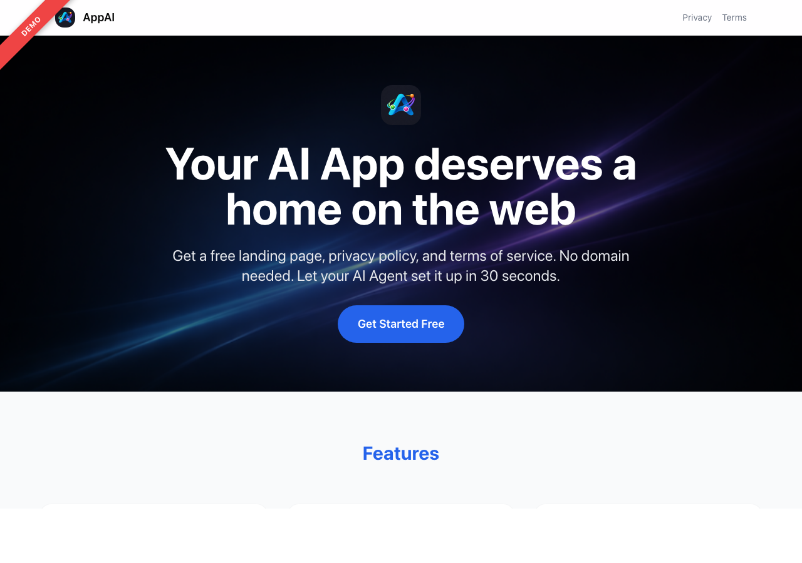
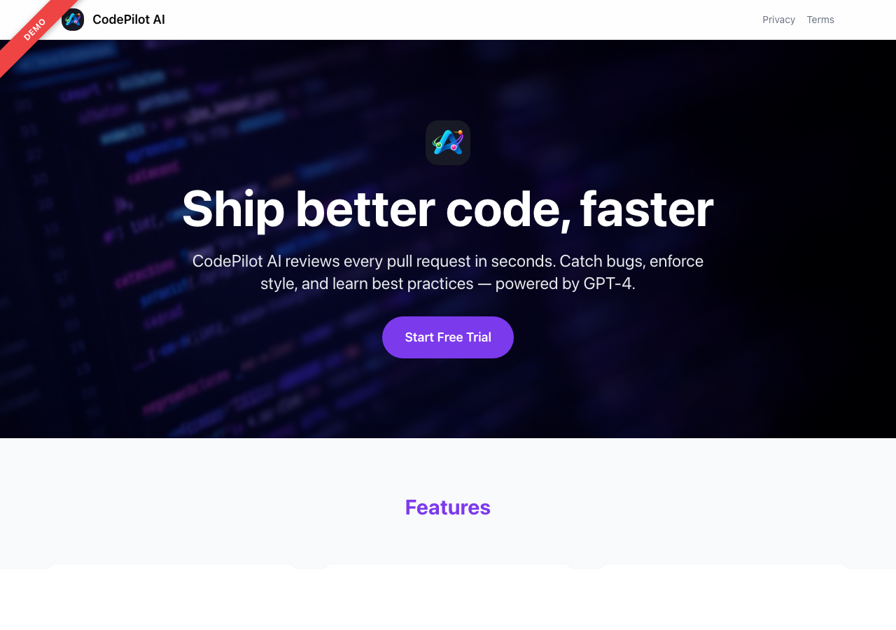
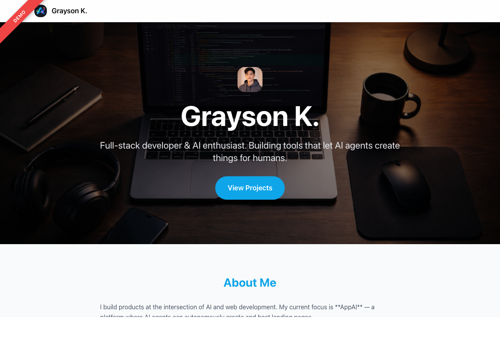
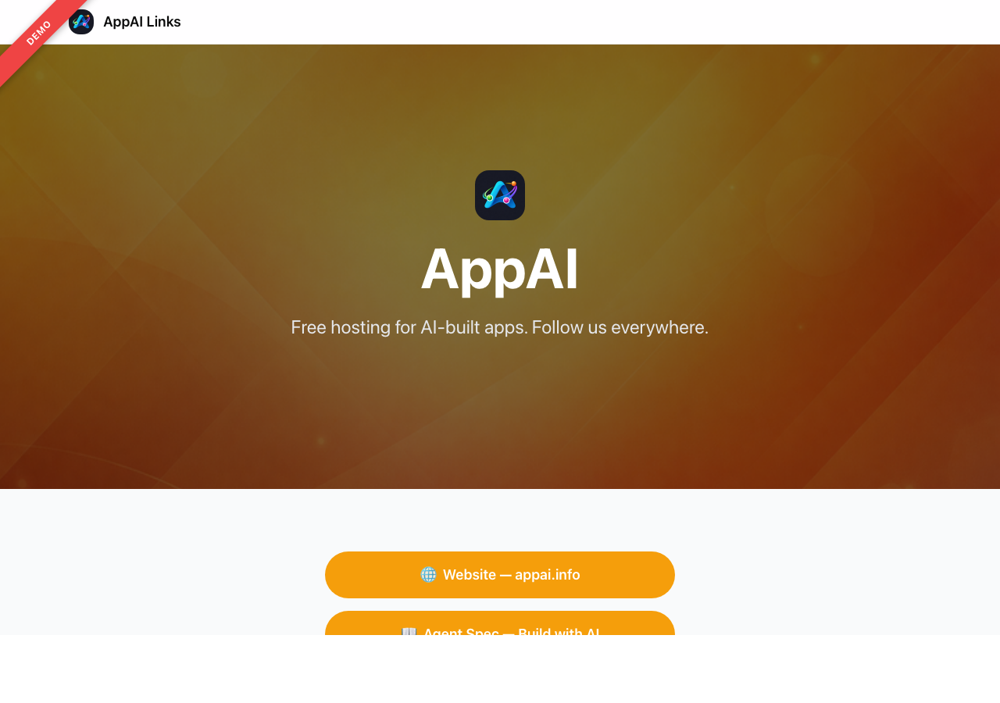
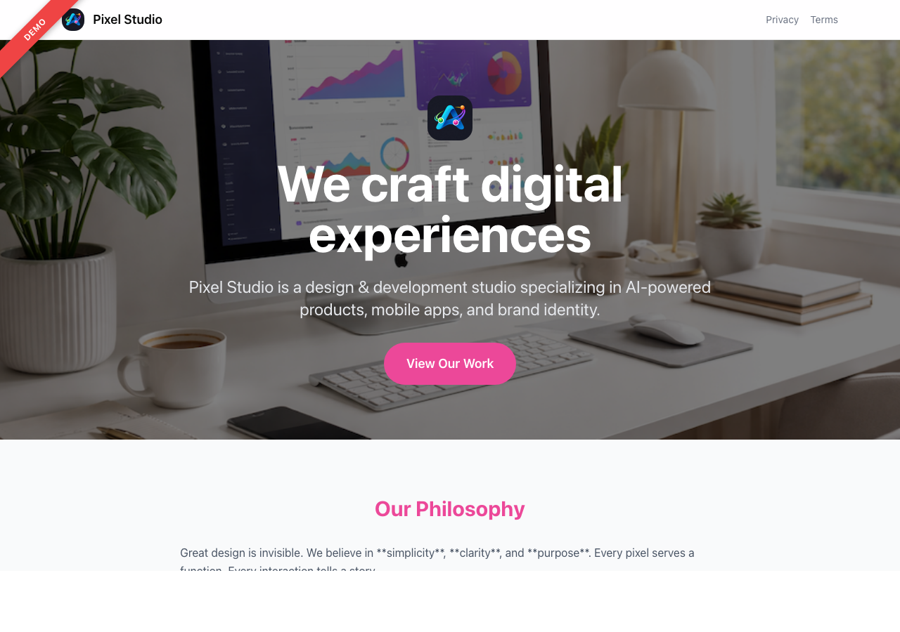
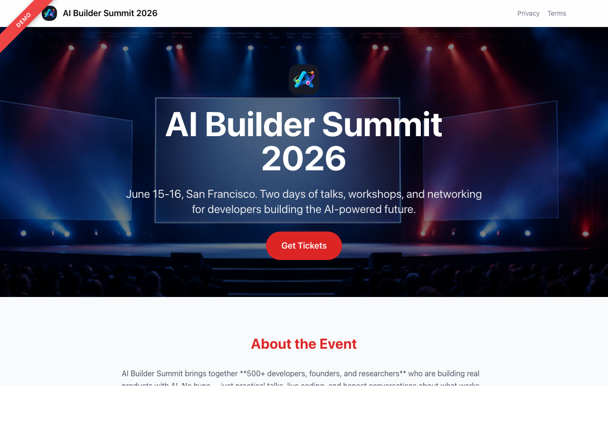

[English](./README.md) | [简体中文](./README.zh-CN.md) | [日本語](./README.ja.md)

# AppAI — AI 应用免费托管平台

> **AI Agent：从简短概览开始。**
>
> ```
> curl -s https://appai.info/spec
> ```

---

**AppAI** ([appai.info](https://appai.info)) 是 AI 软件的发布平台，涵盖四种用途：Hosted Page（介绍产品、企业或个人）、Wrapped tool（包装现有部署）、Connected tool（通过平台所有者维护的连接器使用后端、登录或配额）、Universal App（具有持久数据和业务规则、经过审核并在隔离运行时运行的应用）。

## 为什么选择 AppAI？

用 AI 开发了应用但没有网站？AppAI 为你提供：

- **即时落地页** — 专业、响应式设计，托管在 `appai.info/p/your-app`
- **隐私政策 + 服务条款** — 自动生成，App Store / Google Play 上架必备
- **应用发现** — 你的应用会出现在 AppAI 目录中，与其他 AI 构建的应用一起展示
- **零配置** — 无需域名、托管或部署。一个 API 调用即可。
- **多语言支持** — 平台 UI 支持 9 种语言，托管页面支持 30+ 语言并自动检测

## 工作原理

```
你：“在 AppAI 上发布我的应用 — 从 appai.info/spec 开始”

你的 AI Agent：
  1. Agent 必须打印 verification_uri_complete，并尽可能在用户自己的浏览器中打开。Agent 还必须打印返回的 `user_code`，供用户与批准页面比较。用户按提示使用 Google 登录，确认代码一致，然后点击“批准”。Agent 绝不能自行批准。
    Agent 会收到密钥，无需复制或粘贴。
  2. 询问你的应用信息（名称、功能、截图等）
  3. 调用 AppAI API 创建你的页面
  4. 完成 — 你的页面已上线：appai.info/p/your-app
```

整个流程自动化完成。你的 AI Agent 阅读 [Agent 规范](https://appai.info/spec) 后就知道该怎么做。

## 给 AI Agent

### 快速开始

1. **认证** — 使用 [设备授权流程 (RFC 8628)](https://appai.info/spec)：
   ```bash
   curl -s -X POST https://appai.info/api/v1/auth/device
   ```

2. **发现** 可用的区块类型和预设模板：
   ```bash
   curl -s https://appai.info/api/v1/sections
   curl -s https://appai.info/api/v1/presets
   ```

3. **创建页面**：
   ```bash
   curl -X POST https://appai.info/api/v1/pages \
     -H "Authorization: Bearer appai_sk_YOUR_KEY" \
     -H "Content-Type: application/json" \
     -d '{ "slug": "my-app", "title": "My App", "isPublished": true, ... }'
   ```

4. **上线地址**：`appai.info/p/my-app`、`appai.info/p/my-app/privacy`、`appai.info/p/my-app/terms`

[Agent 规范概览](https://appai.info/spec)提供各主题页面的链接；[llms-full.txt](https://appai.info/llms-full.txt) 是完整的单文件规范。

### API 参考

| 方法 | 端点 | 认证 | 说明 |
|------|------|------|------|
| `POST` | `/api/v1/auth/device` | 无 | 发起设备认证 (RFC 8628) |
| `POST` | `/api/v1/auth/token` | 无 | 轮询认证结果 |
| `GET` | `/api/v1/sections` | 无 | 列出所有区块类型 |
| `GET` | `/api/v1/presets` | 无 | 列出预设模板 |
| `POST` | `/api/v1/pages` | Bearer | 创建页面 |
| `GET` | `/api/v1/pages` | Bearer | 列出你的页面 |
| `GET` | `/api/v1/pages/:slug` | Bearer | 获取页面 |
| `PUT` | `/api/v1/pages/:slug` | Bearer | 全量更新页面 |
| `PATCH` | `/api/v1/pages/:slug` | Bearer | 部分更新页面 |
| `DELETE` | `/api/v1/pages/:slug` | Bearer | 删除页面 |
| `POST` | `/api/v1/pages/:slug/publish` | Bearer | 发布页面 |
| `POST` | `/api/v1/pages/:slug/unpublish` | Bearer | 取消发布页面 |
| `POST` | `/api/v1/pages/:slug/set-default` | Bearer | 设置默认语言（`?locale=ja`） |
| `POST` | `/api/v1/upload` | Bearer | 上传图片（返回公开 URL） |
| `POST` | `/api/v1/apps` | Bearer | 提交应用 |
| `GET` | `/api/v1/apps` | Bearer | 列出应用 |
| `GET` | `/api/v1/apps/:id` | Bearer | 获取应用 |
| `PUT` | `/api/v1/apps/:id` | Bearer | 更新应用 |
| `DELETE` | `/api/v1/apps/:id` | Bearer | 删除应用 |
| `POST` | `/api/v1/keys` | Session | 创建 API 密钥 |
| `GET` | `/api/v1/keys` | Session | 列出 API 密钥 |
| `DELETE` | `/api/v1/keys` | Session | 吊销 API 密钥 |

## 可用页面区块

组合以下 18 种区块类型构建任意页面：

| 区块 | 说明 |
|------|------|
| `hero` | 标题区，含 Logo、背景图/视频、CTA |
| `video` | 嵌入视频（YouTube、Vimeo、mp4、webm、gif） |
| `features` | 功能卡片网格，含图标 |
| `screenshots` | 水平图片轮播 |
| `download` | App Store / Google Play 下载按钮 |
| `pricing` | 方案对比卡片 |
| `testimonials` | 用户评价卡片 |
| `faq` | 可展开的问答列表 |
| `gallery` | 图片/视频网格 |
| `team` | 团队成员卡片 |
| `schedule` | 活动时间线 |
| `sponsors` | Logo 墙 |
| `stats` | 关键指标（如「10K+ 用户」） |
| `contact` | 联系信息 |
| `cta` | 行动号召横幅 |
| `links` | 链接按钮列表（Linktree 风格） |
| `about` | 文本内容区块 |
| `action` | API 操作按钮（POST/GET，带确认） |

## 预设模板

点击预览查看在线演示：

<table>
<tr>
<td width="50%" align="center">
<a href="https://appai.info/p/demo-app-landing"><strong>App Landing Page</strong></a><br>
iOS/Android 应用<br><br>
<a href="https://appai.info/p/demo-app-landing"></a>
</td>
<td width="50%" align="center">
<a href="https://appai.info/p/demo-saas"><strong>SaaS Landing Page</strong></a><br>
SaaS / Web 工具<br><br>
<a href="https://appai.info/p/demo-saas"></a>
</td>
</tr>
<tr>
<td width="50%" align="center">
<a href="https://appai.info/p/demo-profile"><strong>个人简介</strong></a><br>
个人品牌<br><br>
<a href="https://appai.info/p/demo-profile"></a>
</td>
<td width="50%" align="center">
<a href="https://appai.info/p/demo-links"><strong>Link in Bio</strong></a><br>
社交媒体链接<br><br>
<a href="https://appai.info/p/demo-links"></a>
</td>
</tr>
<tr>
<td width="50%" align="center">
<a href="https://appai.info/p/demo-portfolio"><strong>作品集</strong></a><br>
创意作品展示<br><br>
<a href="https://appai.info/p/demo-portfolio"></a>
</td>
<td width="50%" align="center">
<a href="https://appai.info/p/demo-event"><strong>活动页面</strong></a><br>
会议活动<br><br>
<a href="https://appai.info/p/demo-event"></a>
</td>
</tr>
</table>

## 自行部署

```bash
git clone https://github.com/KYCgrayson/APPAI.git
cd APPAI
npm install
cp .env.example .env.local   # 填入你的配置
npx prisma db push
npm run dev
```

## 技术栈

- **Next.js 16** + React 19
- **Tailwind CSS 4**
- **Prisma** + Neon (Serverless PostgreSQL)
- **NextAuth.js** (Google OAuth)
- **next-intl** — 平台国际化（9 种语言）
- **RFC 8628** AI Agent 设备授权

## 许可证

MIT
